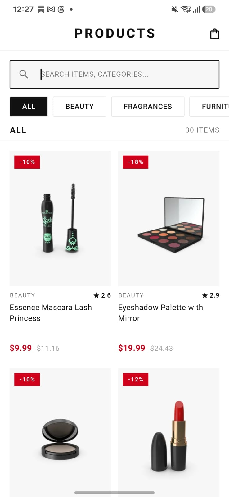

# BAB IV - PRODUCT EXPLORER

## 1. Project Overview

**Product Explorer** merupakan aplikasi Flutter untuk menjelajahi katalog produk melalui layanan REST API.

Pada praktikum ini, mahasiswa akan mengembangkan aplikasi yang sebelumnya menggunakan data statis menjadi aplikasi yang mengambil dan mengelola data dari sumber eksternal.

Aplikasi menggunakan **DummyJSON API** sebagai penyedia data produk. Mahasiswa akan mempelajari cara melakukan HTTP request, menerima respons dari server, mengonversi JSON menjadi objek Dart, serta menampilkan data tersebut ke dalam antarmuka Flutter.

Starter project telah menyediakan sebagian implementasi layanan API dan tampilan katalog produk. Mahasiswa bertanggung jawab melengkapi integrasi API dan mengembangkan fitur yang belum tersedia.

**Project Name:** Product Explorer

**API Provider:** DummyJSON

**API Documentation:** https://dummyjson.com/docs/products

**Fokus Praktikum:**
- REST API Integration
- HTTP Request and Response
- JSON Parsing
- Asynchronous Programming
- Future and FutureBuilder
- Search and Category Filtering
- Pagination
- API Error Handling
- CRUD Operations

## 2. Application Overview

Aplikasi Product Explorer dikembangkan untuk menyediakan pengalaman menjelajahi katalog produk.

Fitur utama aplikasi meliputi:

1. Menampilkan katalog produk dari REST API.
2. Menampilkan informasi detail produk.
3. Melakukan pencarian berdasarkan nama produk dan kategori.
4. Memfilter produk berdasarkan kategori.
5. Menambahkan produk baru melalui API.
6. Mengubah informasi produk.
7. Menghapus produk.
8. Menangani kondisi loading, error, dan data kosong.

### Application Interface



Gambar di atas merupakan ilustrasi rancangan tampilan dan alur fitur aplikasi. Implementasi akhir dapat disesuaikan selama memenuhi seluruh functional requirements.

## 3. Starter Project

Starter project telah menyediakan beberapa komponen dasar.

| Komponen | Keterangan |
|---|---|
| `Product` | Model untuk merepresentasikan data produk |
| `ProductService` | Abstract class untuk kontrak layanan API |
| `ProductServiceImpl` | Implementasi komunikasi dengan REST API |
| `ProductListScreen` | Halaman katalog produk |
| `ProductCard` | Widget untuk menampilkan ringkasan produk |
| `AppTheme` | Konfigurasi tema dan desain aplikasi |
| `.env` | Konfigurasi alamat API |

### Existing Implementation

Beberapa bagian starter sudah tersedia:

- HTTP GET untuk mengambil daftar produk.
- Parsing JSON menjadi objek `Product`.
- Penanganan loading state.
- Penanganan error ketika request gagal.
- Penanganan data kosong.
- Pencarian berdasarkan nama dan kategori.
- Filter berdasarkan kategori.
- Tampilan katalog menggunakan GridView.
- Tombol retry ketika API mengalami kegagalan.

### Incomplete Implementation

Mahasiswa harus melengkapi atau mengembangkan bagian berikut:

- Pengambilan detail produk berdasarkan ID.
- Implementasi Create Product.
- Implementasi Update Product.
- Implementasi Delete Product.
- Halaman detail produk.
- Form tambah dan edit produk.
- Dialog konfirmasi penghapusan.
- Pagination atau pemuatan data secara bertahap.
- Integrasi hasil operasi API dengan tampilan aplikasi.

## 4. Project Structure

Struktur project yang digunakan:

```text
lib/
├── core/
│   └── theme/
│       └── app_theme.dart
├── models/
│   └── product.dart
├── services/
│   └── product_service.dart
├── screens/
│   ├── product_list_screen.dart
│   ├── product_detail_screen.dart
│   └── product_form_screen.dart
├── widgets/
│   └── product_card.dart
└── main.dart

assets/
└── images/
    └── overview.jpeg

.env
.env.example
pubspec.yaml
```

Keterangan:

| Folder/File | Fungsi |
|---|---|
| `models/` | Mendefinisikan struktur data produk |
| `services/` | Mengelola komunikasi dengan REST API |
| `screens/` | Menyimpan halaman aplikasi |
| `widgets/` | Menyimpan komponen UI yang digunakan kembali |
| `core/theme/` | Mengatur tema aplikasi |
| `.env` | Menyimpan konfigurasi URL API |
| `main.dart` | Entry point aplikasi |

Mahasiswa diperbolehkan menyesuaikan struktur folder jika diperlukan, tetapi pemisahan antara model, service, screen, dan widget harus tetap dipertahankan.

## 5. API Configuration

Aplikasi menggunakan DummyJSON sebagai sumber data produk.

Base URL:

```text
https://dummyjson.com
```

### 5.1 Environment Configuration

Alamat API harus dikonfigurasi menggunakan file `.env`.

Contoh isi `.env`:

```env
BASE_URL=https://dummyjson.com
```

Contoh `.env.example`:

```env
BASE_URL=https://dummyjson.com
```

Pastikan file `.env` telah dimuat sebelum aplikasi dijalankan.

Contoh konfigurasi pada `main.dart`:

```dart
Future<void> main() async {
  WidgetsFlutterBinding.ensureInitialized();

  await dotenv.load(fileName: ".env");

  runApp(const MyApp());
}
```

Ketentuan:

- Gunakan `flutter_dotenv` untuk membaca konfigurasi.
- Jangan menuliskan alamat API secara berulang pada setiap screen.
- Gunakan `BASE_URL` sebagai sumber konfigurasi.
- Sertakan `.env.example` dalam repository.
- Jangan memasukkan file `.env` yang berisi konfigurasi pribadi ke repository publik.

### 5.2 Dependencies

Package yang digunakan:

```yaml
dependencies:
  flutter:
    sdk: flutter

  http: ^1.6.0
  flutter_dotenv: ^6.0.2
```

Versi package dapat disesuaikan dengan versi yang kompatibel pada lingkungan pengembangan.

## 6. REST API Endpoints

Gunakan endpoint resmi DummyJSON berikut.

### 6.1 Get All Products

Mengambil daftar produk.

```http
GET /products
```

Contoh:

```text
https://dummyjson.com/products
```

Respons API menyediakan daftar produk beserta informasi pagination seperti `total`, `skip`, dan `limit`.

### 6.2 Get Product by ID

Mengambil detail produk berdasarkan ID.

```http
GET /products/1
```

### 6.3 Search Products

Melakukan pencarian produk.

```http
GET /products/search?q=phone
```

### 6.4 Get Product Categories

Mengambil daftar kategori produk.

```http
GET /products/categories
```

### 6.5 Pagination

Mengambil produk berdasarkan jumlah data dan posisi awal.

```http
GET /products?limit=10&skip=10
```

Keterangan:

- `limit`: jumlah produk yang diambil.
- `skip`: jumlah produk yang dilewati.

### 6.6 Create Product

Menambahkan produk baru.

```http
POST /products/add
```

Contoh request body:

```json
{
  "title": "Wireless Headphone",
  "description": "Wireless headphone for daily use",
  "price": 49.99,
  "category": "beauty"
}
```

### 6.7 Update Product

Memperbarui data produk.

```http
PUT /products/1
```

Contoh request body:

```json
{
  "title": "Updated Product Name",
  "price": 59.99
}
```

### 6.8 Delete Product

Menghapus produk berdasarkan ID.

```http
DELETE /products/1
```

Dokumentasi lengkap endpoint:

https://dummyjson.com/docs/products

**Important:** DummyJSON menggunakan simulasi operasi penulisan data. Respons Create, Update, dan Delete dapat menunjukkan keberhasilan operasi, tetapi perubahan tidak benar-benar disimpan secara permanen pada database server. Oleh karena itu, jangan menganggap data hasil operasi akan tetap tersedia setelah aplikasi mengambil ulang data dari server.

## 7. Functional Requirements

### 7.1 Product List

Aplikasi harus dapat mengambil dan menampilkan katalog produk dari REST API.

Ketentuan:

1. Data produk harus berasal dari API, bukan hardcoded list.
2. Setiap produk ditampilkan menggunakan `ProductCard`.
3. Tampilan menggunakan GridView dengan dua kolom.
4. Setiap card menampilkan informasi utama produk.
5. Informasi harga dan diskon ditampilkan sesuai data API.
6. Gambar produk diambil dari URL yang tersedia pada respons API.
7. Jumlah produk yang ditampilkan harus sesuai dengan hasil request.

Informasi minimum pada ProductCard:

- Gambar produk.
- Nama produk.
- Kategori.
- Harga.
- Rating.
- Informasi diskon jika tersedia.

### 7.2 Product Detail

Pengguna dapat membuka informasi lengkap sebuah produk.

Ketentuan:

- Detail produk diambil berdasarkan ID.
- Tampilkan gambar produk.
- Tampilkan nama dan kategori.
- Tampilkan deskripsi.
- Tampilkan harga.
- Tampilkan rating.
- Tampilkan informasi diskon jika tersedia.
- Sediakan navigasi kembali ke katalog produk.

Gunakan endpoint:

```http
GET /products/{id}
```

Data detail harus sesuai dengan produk yang dipilih pengguna.

### 7.3 Search Products

Fitur pencarian digunakan untuk menemukan produk berdasarkan kata kunci.

Ketentuan:

- Pengguna dapat memasukkan kata kunci melalui Search Field.
- Pencarian dilakukan berdasarkan nama produk dan kategori.
- Pencarian dapat menggunakan endpoint search API.
- Hasil pencarian harus sesuai dengan kata kunci.
- Tampilkan pesan jika produk tidak ditemukan.
- Ketika input dikosongkan, katalog dapat dikembalikan ke kondisi awal.

Mahasiswa dapat memilih pendekatan pencarian lokal atau pencarian melalui endpoint API, tetapi harus dapat menjelaskan perbedaannya.

### 7.4 Category Filtering

Pengguna dapat memfilter produk berdasarkan kategori.

Ketentuan:

- Kategori diperoleh dari API.
- Daftar kategori tidak boleh hanya dibuat secara hardcoded.
- Sediakan pilihan `ALL` untuk menampilkan seluruh produk.
- Pengguna dapat memilih kategori tertentu.
- Daftar produk harus diperbarui sesuai kategori yang dipilih.

Gunakan endpoint:

```http
GET /products/categories
```

### 7.5 Pagination

Mahasiswa harus mengimplementasikan pemuatan produk secara bertahap menggunakan parameter `limit` dan `skip`.

Ketentuan:

- Produk tidak harus dimuat seluruhnya sekaligus.
- Setiap request mengambil sejumlah data sesuai `limit`.
- Nilai `skip` diperbarui ketika meminta halaman berikutnya.
- Hindari request berulang ketika request sebelumnya belum selesai.
- Hentikan pemuatan ketika seluruh data telah diambil.
- Tampilkan indikator loading ketika data tambahan sedang dimuat.

Contoh:

```text
Request 1:
GET /products?limit=10&skip=0

Request 2:
GET /products?limit=10&skip=10

Request 3:
GET /products?limit=10&skip=20
```

Mahasiswa dapat menggunakan mekanisme scroll pagination atau tombol Load More.

### 7.6 Create Product

Pengguna dapat menambahkan produk baru melalui halaman form.

Field yang wajib tersedia:

- Product Title.
- Category.
- Price.
- Description.

Field tambahan:

- Discount Percentage.
- Rating.
- Image URL.

Ketentuan:

- Gunakan `TextEditingController` untuk mengelola input.
- Lakukan validasi terhadap field wajib.
- Harga harus berupa angka yang valid.
- Input kosong tidak boleh dikirim.
- Gunakan HTTP POST untuk mengirim data.
- Tampilkan feedback ketika request berhasil atau gagal.
- Setelah berhasil, produk baru dapat ditampilkan pada katalog aplikasi.

Endpoint:

```http
POST /products/add
```

### 7.7 Update Product

Pengguna dapat mengubah informasi produk yang tersedia.

Ketentuan:

- Form edit harus terisi dengan data produk sebelumnya.
- Pengguna dapat mengubah informasi produk.
- Lakukan validasi sebelum mengirim perubahan.
- Gunakan HTTP PUT atau PATCH sesuai kebutuhan.
- Gunakan ID produk sebagai identitas data yang diperbarui.
- Tampilkan feedback setelah proses selesai.
- Perubahan yang berhasil harus tercermin pada tampilan aplikasi.

Endpoint:

```http
PUT /products/{id}
```

### 7.8 Delete Product

Pengguna dapat menghapus produk.

Ketentuan:

- Sediakan tombol atau menu delete.
- Tampilkan dialog konfirmasi.
- Pengguna dapat membatalkan penghapusan.
- Gunakan HTTP DELETE.
- Tampilkan feedback setelah operasi selesai.
- Perbarui tampilan katalog setelah penghapusan berhasil.

Endpoint:

```http
DELETE /products/{id}
```

## 8. Asynchronous State Management

Komunikasi dengan REST API membutuhkan proses asynchronous.

Mahasiswa wajib memahami penggunaan:

- `Future`
- `async` dan `await`
- `FutureBuilder`
- `ConnectionState`
- `try-catch`
- `setState()`

### 8.1 Loading State

Ketika request API sedang berlangsung:

- Tampilkan indikator loading.
- Hindari menampilkan data seolah-olah sudah tersedia.
- Cegah pengguna menjalankan request yang sama berulang kali tanpa kebutuhan.

### 8.2 Success State

Ketika request berhasil:

- Tampilkan data dari API.
- Pastikan JSON telah dikonversi menjadi model Dart.
- Tampilkan informasi sesuai kebutuhan UI.

### 8.3 Empty State

Ketika API berhasil memberikan respons tetapi tidak terdapat data:

- Tampilkan pesan bahwa produk tidak tersedia.
- Jangan menampilkan error yang tidak sesuai.
- Berikan informasi yang mudah dipahami pengguna.

### 8.4 Error State

Ketika request gagal:

- Tampilkan pesan kegagalan.
- Jangan menyebabkan aplikasi crash.
- Sediakan tombol untuk mencoba kembali.
- Tangani kemungkinan koneksi internet terputus.
- Tangani respons HTTP yang tidak berhasil.

## 9. Product Service Requirements

Gunakan abstraksi `ProductService` yang telah disediakan.

Kontrak service:

```dart
abstract class ProductService {
  Future<List<Product>> getProducts();

  Future<Product> getProductById(String id);

  Future<void> createProduct(Product product);

  Future<void> updateProduct(Product product);

  Future<void> deleteProduct(String id);
}
```

Ketentuan:

1. Seluruh komunikasi HTTP harus dikelola melalui service.
2. Screen tidak boleh melakukan HTTP request secara langsung.
3. Gunakan `http` package untuk mengirim request.
4. Gunakan `jsonDecode()` untuk membaca respons JSON.
5. Gunakan `jsonEncode()` untuk mengirim request body.
6. Gunakan model `Product` untuk merepresentasikan data.
7. Tangani status code dan error response.
8. Gunakan exception yang sesuai ketika request gagal.

Mahasiswa diperbolehkan mengembangkan method tambahan pada service jika diperlukan untuk mendukung search, kategori, dan pagination.

## 10. UI and Design Requirements

Pertahankan desain visual starter project dan gunakan konfigurasi `AppTheme` yang telah disediakan.

### 10.1 Color Palette

Gunakan warna sesuai konfigurasi tema aplikasi.

- Background utama: putih atau warna terang sesuai tema.
- Surface: putih.
- Primary: hitam.
- Primary Text: hitam atau abu-abu gelap.
- Secondary Text: abu-abu.
- Discount Badge: merah.
- Border: abu-abu terang.

### 10.2 Typography

- Judul halaman harus mudah dibaca.
- Nama produk memiliki penekanan visual.
- Harga produk harus terlihat jelas.
- Informasi tambahan menggunakan ukuran teks lebih kecil.
- Gunakan konsistensi typography dari `AppTheme`.

### 10.3 Layout

- Katalog menggunakan GridView dua kolom.
- Search Field berada di bagian atas katalog.
- Kategori menggunakan horizontal scrolling.
- ProductCard memiliki ukuran yang konsisten.
- Gambar produk tidak boleh terpotong secara tidak wajar.
- Gunakan scrolling untuk konten yang melebihi tinggi layar.

### 10.4 Responsiveness

- Tidak diperbolehkan terdapat `RenderFlex overflow`.
- Teks panjang harus ditangani dengan benar.
- Tombol tidak boleh keluar dari batas layar.
- Gambar harus menyesuaikan ukuran komponen.
- Layout harus tetap nyaman digunakan pada layar kecil.

## 11. Testing Requirements

Mahasiswa wajib melakukan pengujian terhadap seluruh fungsi aplikasi.

### API Testing

- [ ] Aplikasi berhasil mengambil data produk.
- [ ] JSON berhasil dikonversi menjadi model Product.
- [ ] Detail produk berhasil diambil berdasarkan ID.
- [ ] API kategori berhasil digunakan.
- [ ] API pencarian berhasil digunakan jika menggunakan pencarian server.
- [ ] Create Product berhasil mengirim request.
- [ ] Update Product berhasil mengirim request.
- [ ] Delete Product berhasil mengirim request.
- [ ] Status code dan error response ditangani.

### Product List Testing

- [ ] Seluruh data produk dapat ditampilkan.
- [ ] Gambar produk berhasil dimuat.
- [ ] Informasi harga ditampilkan dengan benar.
- [ ] Rating ditampilkan dengan benar.
- [ ] Informasi diskon ditampilkan dengan benar.

### Search and Category Testing

- [ ] Pencarian produk berjalan.
- [ ] Filter kategori berjalan.
- [ ] Pilihan ALL menampilkan seluruh produk.
- [ ] Empty search result ditangani.
- [ ] Kombinasi search dan kategori menghasilkan data yang sesuai.

### Pagination Testing

- [ ] Data dapat dimuat secara bertahap.
- [ ] Parameter limit dan skip bekerja.
- [ ] Tidak terjadi duplikasi produk akibat request berulang.
- [ ] Loading indicator ditampilkan saat mengambil data berikutnya.
- [ ] Pemuatan berhenti ketika seluruh data telah diambil.

### CRUD Testing

- [ ] Pengguna dapat menambahkan produk.
- [ ] Form melakukan validasi.
- [ ] Pengguna dapat mengubah produk.
- [ ] Form edit terisi dengan data sebelumnya.
- [ ] Pengguna dapat menghapus produk.
- [ ] Dialog konfirmasi penghapusan berfungsi.
- [ ] Tampilan katalog diperbarui setelah operasi CRUD.

### Error Handling Testing

- [ ] Loading state ditampilkan.
- [ ] Error state ditampilkan ketika request gagal.
- [ ] Empty state ditampilkan ketika data kosong.
- [ ] Tombol retry dapat digunakan.
- [ ] Aplikasi tidak crash ketika koneksi internet terputus.

### UI Testing

- [ ] Tampilan mengikuti desain starter.
- [ ] Tidak terdapat overflow.
- [ ] Grid produk dapat di-scroll.
- [ ] Kategori dapat di-scroll secara horizontal.
- [ ] Product Detail dapat menampilkan informasi lengkap.
- [ ] Form dapat digunakan dengan baik.

## 12. Testing API Behavior

DummyJSON menyediakan data untuk latihan integrasi API, tetapi memiliki karakteristik tertentu yang harus dipahami.

| Operasi | Perilaku |
|---|---|
| GET | Mengambil data produk yang tersedia |
| POST | Mengembalikan simulasi produk baru |
| PUT/PATCH | Mengembalikan simulasi hasil perubahan |
| DELETE | Mengembalikan simulasi hasil penghapusan |

**Penting:** Operasi POST, PUT, PATCH, dan DELETE pada DummyJSON tidak mengubah database secara permanen.

Karena itu:

- Jangan menganggap produk yang dibuat akan tetap tersedia setelah aplikasi mengambil ulang data.
- Jangan menganggap perubahan produk akan tersimpan secara permanen.
- Jangan menganggap produk yang dihapus benar-benar hilang dari database server.

Untuk pengujian tampilan, mahasiswa dapat memperbarui state lokal berdasarkan respons API agar hasil operasi terlihat pada aplikasi selama sesi penggunaan.

## 13. Code Quality Requirements

- Pisahkan model, service, screen, dan widget.
- Hindari HTTP request langsung di dalam widget UI.
- Gunakan `async` dan `await` secara tepat.
- Gunakan `try-catch` untuk menangani error.
- Hindari duplikasi kode.
- Gunakan nama class dan variabel yang jelas.
- Gunakan model Dart untuk membaca respons API.
- Jangan menempatkan seluruh implementasi dalam `main.dart`.
- Pastikan tidak terdapat error yang menyebabkan aplikasi crash.

## 14. Submission Requirements

Mahasiswa wajib mengumpulkan:

1. Source code aplikasi Flutter.
2. Screenshot Product List.
3. Screenshot Product Detail.
4. Screenshot halaman Add Product.
5. Screenshot halaman Edit Product.
6. Screenshot dialog Delete Product.
7. Screenshot loading, error, dan empty state.
8. Dokumentasi endpoint API yang digunakan.
9. Dokumentasi hasil pengujian API.
10. README project yang menjelaskan cara konfigurasi dan menjalankan aplikasi.

Pastikan repository memiliki file `.env.example` dan petunjuk konfigurasi `.env`.

Jangan mengunggah file `.env` yang berisi konfigurasi pribadi ke repository publik.

## 15. Evaluation Criteria

| Aspek Penilaian | Bobot |
|---|---:|
| REST API Integration | 25% |
| JSON Parsing and Data Modeling | 15% |
| Asynchronous State and Error Handling | 15% |
| Search, Category, and Pagination | 15% |
| CRUD Implementation | 20% |
| Code Quality and Documentation | 10% |
| **Total** | **100%** |

## 16. Final Goal

Mahasiswa mampu mengembangkan aplikasi Flutter yang terhubung dengan REST API, memahami proses komunikasi client-server, melakukan parsing data JSON, mengelola asynchronous state, serta mengimplementasikan fitur pengelolaan produk.

**Project Completion Criteria:** Aplikasi dapat mengambil dan menampilkan data produk dari API, melakukan pencarian dan filter kategori, memuat data secara bertahap, menampilkan detail produk, serta mengimplementasikan operasi Create, Update, dan Delete dengan penanganan respons API yang tepat.